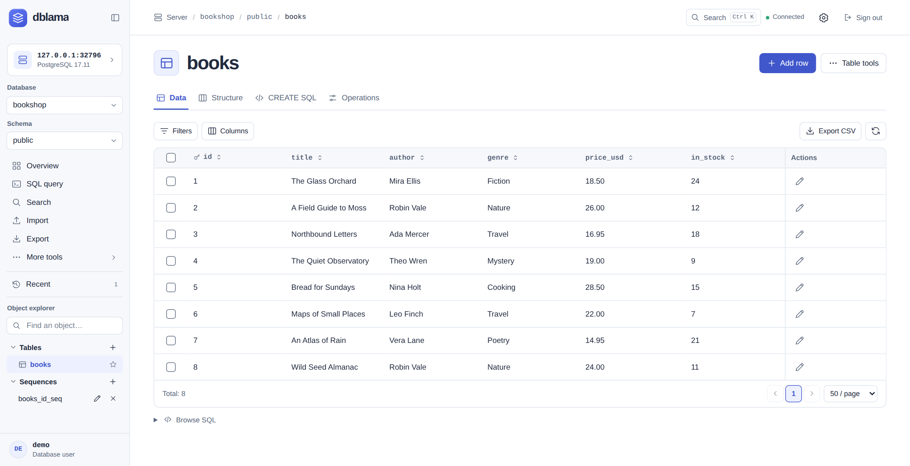

# dblama

dblama is a self-hosted web interface for MySQL, MariaDB and PostgreSQL. A single Go executable serves the Vue interface. Sign in with your database credentials to browse tables, edit rows and schemas, run SQL, and import or export data.



## Quick start

Choose either option below and run the commands from the repository root. Once dblama is running, open [localhost:8080](http://localhost:8080) and sign in with your database credentials.

### Docker

```sh
docker build -t dblama .
docker run --rm -p 127.0.0.1:8080:8080 dblama
```

Use a database hostname reachable from the container. If your database runs in another container, attach dblama to the same Docker network and use the database container's name.

### Local build

Requires Go 1.26.8 or newer, Node.js 24, npm and Make.

```sh
npm --prefix frontend ci
make build
./dblama
```

## Environment variables

dblama reads these settings at startup. Unset or empty variables use the defaults below.

| Variable | Default | Description |
| --- | --- | --- |
| `LISTEN` | `:8080` | HTTP listen address. The default binds to all interfaces. Use `127.0.0.1:8080` for local access only. |
| `SESSION_TTL` | `30m` | How long a session can stay idle. Accepts Go durations such as `15m` or `2h`. |
| `LOGIN_RATE_LIMIT` | `10/min` | Maximum failed logins per client IP. Use a positive count per minute (`10/min`) or second (`2/s`). |
| `TRUSTED_SERVERS` | Empty | Comma-separated database targets, for example `db.internal:5432,mysql.internal:3306`. An empty value allows any reachable database server. |

## Deployment

For remote access, serve dblama behind an HTTPS reverse proxy. Database connections use unencrypted transport, so keep the database on a trusted network.

To run the development servers or test a change, see the [development guide](docs/dev.md).
