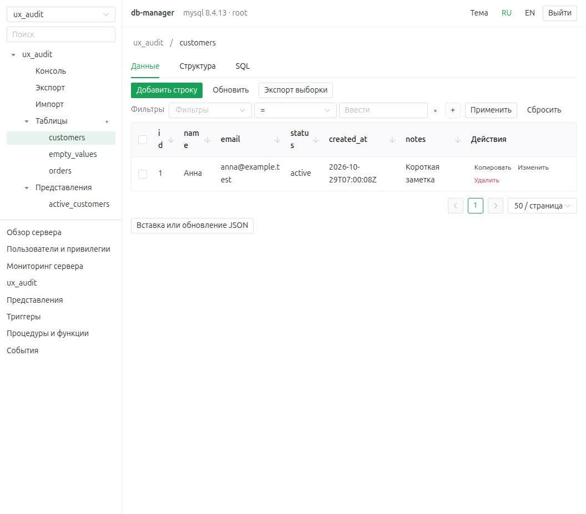
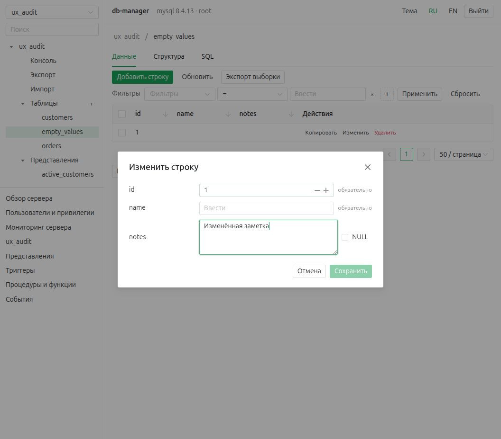
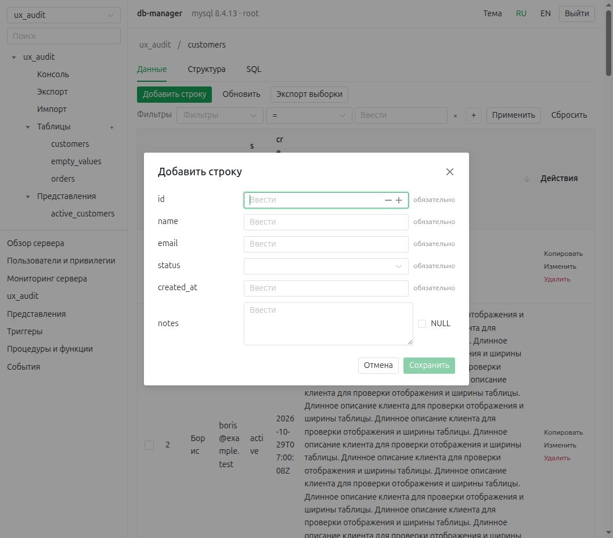
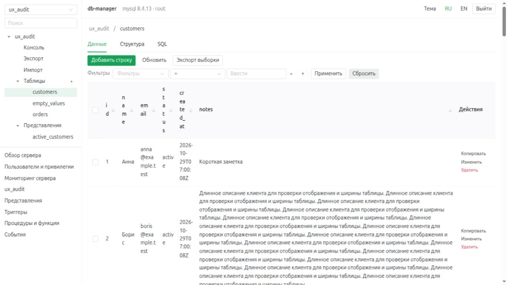

# Аудит функциональности и удобства db-manager

Дата: 29 октября 2026. Проверенный commit: `b9cc918`.
Это результаты проверки и предложения, а не согласованный проект реализации.
Код приложения не менялся.

## Что проверено

Собран текущий frontend и Go-сервер. Штатные Playwright-сценарии запущены последовательно на отдельных временных контейнерах:

| СУБД | Результат | Лог |
| --- | --- | --- |
| MySQL 8.4 | 13/13 passed, exit 0 | [e2e-mysql.log](e2e-mysql.log) |
| MariaDB 11.4 | 13/13 passed | [e2e-mariadb.log](e2e-mariadb.log) |
| PostgreSQL 17 | 13/13 passed, общий процесс MariaDB → PostgreSQL завершился с exit 0 | [e2e-postgres.log](e2e-postgres.log) |

Покрытие: вход/выход, структура и AUTO_INCREMENT/PK, CRUD/копирование/upsert, фильтры/сортировка/страницы, SQL/EXPLAIN, SQL и CSV roundtrip, жизненный цикл БД, представления и мониторинг. Успешные тесты не означают отсутствие перечисленных ниже проблем: эти сценарии в наборе не проверяются.

Дополнительно вручную проверен интерфейс на отдельной MySQL: список БД и таблиц, грид с 60 строками и длинным TEXT, вставка/редактирование, FK, переходы между вкладками и SQL-консолью, редакторы структуры и представлений, список пользователей, импорт/экспорт. Размеры окна: исходный 1056×927, 1366×768 и 768×900. В журнале браузера после этих действий ошибок уровня error не было. Полный ручной аудит PostgreSQL, всех административных операций, мобильных устройств и доступности не проводился.

Все данные синтетические, из [fixture.sql](fixture.sql). Существующие пользовательские БД не использовались. Временные сервер и контейнер после проверки остановлены и удалены. Автоматизация удаления/изменения данных работала только с контейнерами тестового runner.

## Что исправить первым

### A1. Фильтр скрывается, но продолжает действовать — P1

**Воспроизведено в браузере:** customers → фильтр `id = 1` → «Применить» → «Структура» → «Данные». Осталась одна строка, но колонка и значение фильтра пусты. Обновление и экспорт продолжают использовать скрытый фильтр.

**Причина:** `TableView.vue:139` хранит применённые фильтры, а `DataGrid.vue:298` отдельно хранит черновики. Переключение `v-if` пересоздаёт DataGrid, не передавая ему действующие фильтры.

**Нужно:** единое состояние запроса и отображаемых фильтров; сохранять фильтры, сортировку и страницу при переходах и возврате назад. По возможности отражать состояние в URL. Критерий: после перехода видны `id`, `=`, `1`, обновление и экспорт соответствуют экрану.

### A2. Допустимая пустая строка блокирует редактирование — P1

**Воспроизведено:** в `empty_values` у строки `name = ''`, колонка `VARCHAR NOT NULL`. Открыть «Изменить», ввести заметку в `notes`. «Сохранить» остаётся отключённой.

**Причина:** `RowModal.vue:308` считает `''` ошибкой для любого NOT NULL поля. SQL различает NULL и пустую строку. Блокируется даже сохранение другого поля существующей записи.

**Нужно:** проверять NULL и ограничения типа отдельно от пустой строки; показывать конкретную ошибку у поля. Критерий: заметка сохраняется, `name` остаётся `''`.

### A3. Форма вставки не даёт нормально использовать DEFAULT — P1

**Воспроизведено:** у customers есть `status DEFAULT 'active'`, `email DEFAULT ''`, `created_at DEFAULT CURRENT_TIMESTAMP`. При открытии вставки поля пусты, статус не выбран; время нужно вводить вручную. AUTO_INCREMENT визуально помечен «обязательно», хотя сохранение без него поддерживается.

**Причины:** форма открывается до завершения `fetchDef()`; её инициализация использует урезанные метаданные и намеренно не повторяется при их обогащении. `initFromDefault()` игнорирует SQL-выражения и пустую строку. `buildValues()` отправляет каждую колонку, а не позволяет оставить её серверному DEFAULT.

**Нужно:** явные состояния «значение / NULL / DEFAULT», корректная загрузка метаданных без стирания пользовательского ввода, подсказка для генерируемого ID. Критерий: достаточно ввести обязательное имя; остальные значения корректно задаёт БД.

### A4. Грид теряет читаемость на длинном TEXT — P1 по удобству

**Воспроизведено:** customers содержит текст примерно на тысячу символов. Даже при 1366×768 столбцы `id`, `name`, `status`, `created_at` переносятся почти по буквам. Один TEXT занимает значительную часть экрана, страницы находятся внизу длинного списка.

**Причина:** обычные текстовые ячейки не ограничены по длине, у колонок нет минимальной ширины и отдельной настройки горизонтальной прокрутки. Ограничение превью предусмотрено для BLOB, но не для TEXT.

**Нужно:** разумные минимальные ширины, краткое превью с раскрытием полного значения, прокрутка внутри грида, закреплённые заголовки/действия, количество найденных строк и навигация сверху и снизу. Критерий: длинная заметка не ломает соседние колонки; редактирование и переход страницы доступны без поиска по экрану.

### A5. Теряется невыполненный SQL — P1

**Воспроизведено:** ввести запрос в консоли → открыть orders → вернуться в консоль. Редактор пуст, предупреждения не было. История выполненных запросов здесь не помогает.

**Причина:** `useConsole.ts:20` создаёт новый `ref('')` при каждом монтировании, редактор уничтожается при уходе. Сохранения черновика нет.

**Нужно:** черновик, привязанный к соединению/БД/схеме; предупреждение при потере несохранённых изменений структуры и SQL-объектов. Для этих двух редакторов отсутствие защиты установлено по коду, отдельный сценарий потери не воспроизводился.

### A6. Одиночное удаление строки без подтверждения — P1

**Установлено по коду:** `DataGrid.vue:221` немедленно испускает `delete-row`, `TableView.vue` отправляет DELETE. Для массового удаления есть `NPopconfirm`, для одиночного — нет. В ручном аудите эту кнопку не нажимал.

**Нужно:** единое подтверждение с таблицей и идентификатором записи. Для таблиц без PK повторять предупреждение о возможном совпадении нескольких строк. Критерий: до подтверждения DELETE не отправляется, отказ ничего не меняет.

## Уже реализовано, но интерфейс не раскрывает возможности

| Возможность | Текущее состояние | Что добавить |
| --- | --- | --- |
| Очистка и удаление таблицы | API: `handlers_tables.go:108,127`; в TableView нет действий | Раздел «Операции» с подтверждением конкретной таблицы |
| Массовая очистка/удаление таблиц | API: `handlers_tables.go:161`; список БД предлагает только копирование/перенос | «Выбрать все» и меню действий с выбранными таблицами |
| Секции таблицы | Есть маршрут `/db/:db/table/:t/partitions`, ObjectsView и API; ссылки из навигации нет | Пункт «Секции» при соответствующей capability |
| Поиск, вставка, импорт/экспорт в контексте таблицы | Части функций существуют, но распределены по гриду и дереву БД | Общая панель действий таблицы; импорт/экспорт с уже выбранной таблицей |
| SQL таблицы | Вкладка SQL показывает CREATE, консоль находится отдельно | Ясно различить «SQL-запрос» и «DDL», переход в консоль с контекстом таблицы |

Это самый выгодный объём после исправления ошибок: большая часть серверной работы уже сделана.

## Как приблизить рабочие сценарии к phpMyAdmin

Ориентир — быстрый переход между действиями для текущего объекта. У phpMyAdmin предусмотрены переходы Browse/Structure/SQL/Search/Insert, настройка действий в дереве, недавние таблицы и ограничение длины отображаемого текста: [официальная конфигурация](https://docs.phpmyadmin.net/en/latest/config.html). Живой интерфейс phpMyAdmin в этом аудите не запускался; сравнение опирается на его документацию.

1. **Один понятный контекст:** кликабельные «Сервер → БД → схема → таблица» и общая панель «Данные / Структура / SQL / Поиск / Вставить / Импорт / Экспорт / Операции». Это разделы текущего объекта, без необходимости добавлять многодокументные вкладки. Сейчас крошки таблицы — просто текст; подсветка дерева может оставаться на orders после открытия представлений.
2. **Полезный список таблиц:** поиск непосредственно в списке, сортировка, быстрые «Данные / Структура / Вставить», отметка VIEW, выбор всех, понятное «примерное число строк» для оценок каталога. Сейчас поиск боковой панели фильтрует только дерево, а таблица БД содержит лишь имя, число строк и размер.
3. **Компактная структура:** сначала обзор колонок одной строкой на колонку; подробные настройки по раскрытию. Сейчас каждая колонка — большая карточка из множества полей, даже для обычного INT. При исходном размере окна видны примерно две полные карточки из шести. Разделить сохранение колонок, индексов и FK визуально, обозначить несохранённые изменения.
4. **Единый стиль:** UsersView/ObjectsView используют обычные кнопки/textarea, а основные формы — Naive UI. SQL объектов стоит редактировать тем же CodeMirror. Сделать едиными размеры, состояния загрузки, ошибки у полей, подтверждения и уведомления.
5. **Клавиатура:** Ctrl/Cmd+Enter для SQL, Enter для применения фильтра, доступные названия у `+`, `×` и чекбоксов строк. Ctrl+Enter проверен: запрос не выполняется; нажатие «Выполнить всё» возвращает результат.
6. **Боковая панель:** сворачивание и изменение ширины, недавние и избранные таблицы, закреплённые общие действия. Сейчас ширина фиксирована в 220 px; ссылки администрирования расположены после дерева и при большом каталоге уйдут ниже.

## Что дописать по функционалу

Порядок ниже — рекомендация по пользе для ежедневной работы.

| Приоритет | Возможность | Зачем / текущий разрыв | Объём |
| --- | --- | --- | --- |
| 1 | Экспорт выбранной MySQL/MariaDB базы без повторного входа | Сейчас сервер принимает только БД из логина, даже если пользователь уже работает с другой. Для PostgreSQL сохранить ограничение соединения одной БД | API и UI |
| 1 | Режимы экспорта «структура / данные / всё» | В `ExportRequest` нет отдельного выбора; нужен для миграций структуры и переноса данных | Драйверы, API, UI |
| 1 | Предпросмотр CSV, сопоставление колонок, понятные пресеты и кнопка остановки импорта | Сейчас надо вручную задать разделитель/кавычки/заголовок; предпросмотра, mapping и кнопки отмены нет. Остановка должна явно сообщать, что уже применённые изменения не откатываются | UI, контракт импорта/отмена |
| 2 | Поиск связанной записи с подписью и переход по FK | Сейчас dropdown показывает только ID; код загружает первые 200 записей, поиск локальный, составные FK пропускаются. Ручной ввод ID остаётся доступным | UI и серверный поиск |
| 2 | Массовое редактирование выбранных строк | Сейчас есть массовые удаление/копирование и JSON upsert. Для изменения статуса у нескольких строк нужна обычная форма и предпросмотр затронутых записей | API и UI |
| 2 | Сохранённые запросы и автодополнение таблиц/колонок | Есть история и ключевые слова SQL, но нет именованных запросов и схемного completion. Сохранять локально с областью соединение/БД; не вводить обязательную служебную БД | Преимущественно UI |
| 2 | Редакторы JSON, даты/времени, boolean, просмотр/загрузка BLOB | Сейчас большинство типов используют текстовый input; конкретные типы уже известны метаданным | UI, местами API |
| 3 | Поиск значения по нескольким таблицам БД | Полезен при разборе незнакомой базы; сейчас поиск данных ограничен текущей таблицей или SQL | API, ограничения нагрузки, UI |

Именованные SQL-закладки как ориентир: [документация phpMyAdmin](https://docs.phpmyadmin.net/en/latest/bookmarks.html). PostgreSQL roles, новые СУБД, SSO и дизайнер связей не предлагаю в ближайший объём: текущие ежедневные сценарии дадут больший эффект и укладываются в существующую спецификацию.

## Рекомендуемые следующие этапы

1. **Надёжность повседневных действий:** A1–A6. Добавить регрессионные сценарии на скрытый фильтр, пустую NOT NULL строку, DEFAULT, черновик и подтверждение удаления; визуально проверить длинный TEXT.
2. **Навигация и доступность существующих функций:** общая панель таблицы, кликабельные крошки, компактная структура, таблицы БД с массовыми действиями, ссылки на секции, единые компоненты.
3. **Новые функции:** сначала экспорт и импорт, затем FK-поиск, массовое редактирование и сохранённые SQL-запросы.

Критерий результата: найти таблицу, отфильтровать данные, проверить структуру, вернуться к тому же результату, изменить строку и экспортировать нужные данные можно без потери контекста и обязательного ручного SQL.
